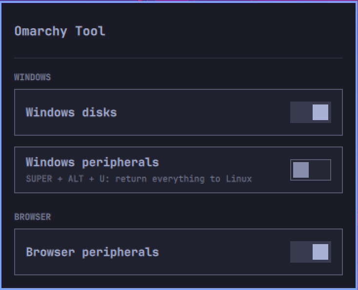

# Omarchy Tool

**English** · [Español](README.es.md)

A plugin for [Omarchy](https://omarchy.org/) with system utilities you turn on
and off with a switch. It adds a bar icon that opens a panel with one module per
feature. The panel uses Omarchy's theme components and colors, so it changes
with your theme.



The panel, its modules, states and notifications follow the system language
(`LC_ALL`, `LC_MESSAGES`, `LANG`). English and Spanish are included; other
languages fall back to English. Disk and device names are kept as they are. The
helpers inside Windows follow the Windows UI language; their file names and
paths stay the same so existing shortcuts keep working.

## Requirements

- Omarchy with the Quickshell shell plugin system (`omarchy plugin`).
- `jq`, `socat`, `acl` (`setfacl`), `polkit` (`pkexec`) and `udev`, all part of
  a standard Omarchy install. Nothing is installed automatically.
- The **Windows** modules need Omarchy's Windows VM (`omarchy-windows-vm`,
  based on the `dockurr/windows` image under Docker), already installed from
  the Omarchy menu.
- Actions that change files owned by root ask for your password through
  `pkexec` every time.

## Install, update and remove

```bash
omarchy plugin add https://github.com/gsus67/omarchy-tool.git --enable
omarchy plugin update io.github.gsus67.omarchy-tool
omarchy plugin remove io.github.gsus67.omarchy-tool
```

The plugin keeps itself up to date: it checks GitHub at startup and every 6
hours, and when there is a new version it runs `omarchy plugin update
io.github.gsus67.omarchy-tool` and shows a notification. `omarchy-tool self-update` does the same
on demand.

Your settings are stored in `~/.config/omarchy-tool/config.json`, outside the
plugin, so updates never erase them.

The plugin adds an **Omarchy Tool** entry to the Omarchy menu (if you have
`~/.config/omarchy/extensions/omarchy-menu.jsonc`).

## Leaves no trace

- **Turning a feature off** removes everything that feature wrote to the
  system. Only your choice is remembered (for example, which disks you ticked).
- **Removing the plugin** puts the system back as it was: it removes the disks
  from the Windows configuration (asks for your password), and deletes the
  plugin settings and the menu entry. Since `omarchy plugin remove` does not run
  plugin code, the cleanup is done by a copy of `bin/uninstall.sh` kept outside
  the plugin, which the panel launches when it is unloaded.
- `omarchy-tool uninstall` runs the same cleanup by hand (see
  [Command line](#command-line)).

Files the plugin may write outside its folder, all removed by the cleanup:

- `~/.config/omarchy-tool/` (settings) and `~/.local/share/omarchy-tool/`
  (state and the uninstaller copy)
- An entry in `~/.config/omarchy/extensions/omarchy-menu.jsonc`
- `~/.config/hypr/omarchy-tool.lua` and one guarded line in `hyprland.lua`
  (the **SUPER + ALT + U** shortcut)
- The `/shared2`, `/shared3` and `/dev/bus/usb` lines in
  `/var/lib/omarchy/windows/docker-compose.yml`
- `/etc/udev/rules.d/70-omarchy-tool-webhid.rules`
- The helpers in the `Omarchy Tool` folder inside the Windows `Shared` folder
  (if drive letters are still set in Windows, **Quitar discos** stays so you
  can remove them, and deletes itself when run)

## Modules

### Disks in Windows

Shares disks with Omarchy's Windows VM the same way Omarchy shares `~/Windows`:
as network folders on `\\host.lan` (`Data2` and `Data3`, next to Omarchy's
`Data`). Tick disks mounted under `/mnt`, `/media` or `/run/media`, or add a
folder by its path (`/home` works too).

**Up to 2 disks at a time**, because the Windows image only serves two extra
folders (`Data2` and `Data3`). To use another one, untick one first.

**Drive letters:** Omarchy gives its Shared folder `Z:` once, when Windows is
installed. For your disks you pick the letter in the panel (`X:` and `Y:` by
default) and the plugin puts an **Activar discos** file in Shared › **Omarchy
Tool › Discos**. It does what Omarchy did (`net use X: \\host.lan\Data2
/persistent:yes` and a desktop shortcut) and also names each drive after the
disk in *This PC* (for example "Data (X:)"). Run it once inside Windows; if you
change letters or disks, run it again. **Quitar discos** undoes it and, if the
plugin is off or removed, deletes itself.

How it works: the `dockurr/windows` image used by Omarchy serves `/shared2` and
`/shared3` when they exist. The plugin adds those two lines to the VM
configuration (`/var/lib/omarchy/windows/docker-compose.yml`, owned by root)
with `bin/compose-edit.sh` through `pkexec`, so every change asks for your
password and takes effect the next time Windows starts. That script only
touches those lines and validates the paths. If you reinstall Windows from
Omarchy, the plugin adds them again.

Because they are network folders, a few very strict installers may refuse to
install onto them.

### Devices in Windows

Passes USB devices to Omarchy's Windows VM so you can use apps that only exist
on Windows (for example **Glorious CORE** for a Glorious Model O 2 mouse).
Windows sees them as if they were plugged into it; **while a device is in
Windows, Linux does not have it** (a USB device can only be in one system at a
time). Up to 4 devices.

- **The feature switch** prepares Windows: the VM gets access to USB
  (`/dev/bus/usb` under `devices`, as documented by `dockurr/windows`), written
  by the same `bin/compose-edit.sh` as the disks, through `pkexec`. It takes
  effect the next time you open Windows.
- **Each device switch** means "in Windows": with Windows open it moves right
  away, otherwise as soon as you open it (the panel watches for it with
  `bin/usb-watch.sh`). Off, it comes back to Linux right away. It uses the VM's
  QEMU monitor (`bin/usb-live.sh`, with `pkexec`).
- **Without a mouse:** **SUPER + ALT + U** returns everything to Linux and
  turns those switches off, even while the Windows window has the keyboard (a
  `dont_inhibit` binding in `~/.config/hypr/omarchy-tool.lua`, loaded by
  `hyprland.lua` with a guarded line). Inside Windows, **Shared › Omarchy Tool ›
  Periféricos › Devolver periféricos a Linux** does the same. When you pass
  something to Windows, a notification reminds you of both ways.

About the cursor: Omarchy shows Windows as a **remote session**; a mouse passed
over USB moves the cursor of the VM's "physical" screen, not the one in that
session. To see it, close the Windows window and use **Open Windows with my
mouse**: it starts Windows without the remote window (`omarchy-windows-vm launch
--keep-alive` with an empty `xfreerdp3` first in `PATH`) and opens its own
screen (the `dockurr/windows` noVNC at `127.0.0.1:8006`) as a web app; sign in
with your Windows password and the passed mouse cursor shows up. When you are
done: **SUPER + ALT + U** and **Shut down Windows**.

### Devices in the browser

Lets the browser talk to the USB devices you tick (WebHID), for web
configurators such as **CORSAIR Web Hub**. Without it, Chromium sees the device
but nothing happens when you click connect, because on Linux only root can use
those devices.

The plugin writes a rule to `/etc/udev/rules.d/70-omarchy-tool-webhid.rules`
(with `bin/udev-webhid.sh` through `pkexec`, so it asks for your password) that
grants access only to your logged-in session. When you untick a device, turn
the feature off or remove the plugin, the rule is deleted and the access already
granted is revoked immediately.

Note: with access, any program in your session can talk to that device (for a
keyboard, that includes reading what you type). Tick only what you are going to
configure, and untick it afterwards if you like.

### Plugins

Turns your installed Omarchy plugins on and off from the panel, with one switch
each. The list comes from `omarchy plugin list`, so plugins you add later show
up by themselves; built-in plugins and Omarchy Tool itself are left out. It
uses Omarchy's own `omarchy plugin enable|disable`: no password, and nothing is
written outside the plugin's settings. When a bar icon is turned off its place
(section and position) is remembered, and it goes back there when turned on.
It changes nothing by itself, so it has no switch of its own in the panel list.
A full bar plugin is listed without a switch: Omarchy can't turn a bar off,
only swap it with `omarchy bar use`.

## Command line

The panel only calls `bin/omarchy-tool`, which you can also use by hand. It is
not on your `PATH`; add an alias first:

```bash
alias omarchy-tool=~/.config/omarchy/plugins/io.github.gsus67.omarchy-tool/bin/omarchy-tool
omarchy-tool status                          # state of every module (JSON)
omarchy-tool uninstall                       # remove every trace outside the plugin
omarchy-tool self-update                     # update now if there is a new version
omarchy-tool windows-disks enable|disable
omarchy-tool windows-disks add /mnt/data [Name]
omarchy-tool windows-disks remove /mnt/data
omarchy-tool windows-disks letter /mnt/data X    # or "next"
omarchy-tool web-devices enable|disable
omarchy-tool web-devices add 1b1c:2b0d            # vendor:product (lsusb)
omarchy-tool web-devices remove 1b1c:2b0d
omarchy-tool usb-windows enable|disable
omarchy-tool usb-windows add 093a:822a            # vendor:product (lsusb)
omarchy-tool usb-windows remove 093a:822a
omarchy-tool usb-windows move linux|windows 093a:822a  # with Windows open
omarchy-tool usb-windows move linux --all            # same as SUPER+ALT+U
omarchy-tool plugins on|off io.github.gsus67.omarchy-taskbar
```

## Adding a module

1. `bin/modules/<name>.sh` with `<name>_<action>` functions. It must have
   `<name>_enable`, `<name>_disable`, `<name>_status` (JSON with `enabled`) and
   `<name>_apply`. When disabled, `apply` must delete everything the module
   wrote; if it touches anything outside its folder, add its cleanup to
   `bin/uninstall.sh`.
2. `modules/<Name>.qml`: the module page. It receives `status` and calls
   `tool.run([...])`.
3. Add it to the `modules` list in `ToolPanel.qml`, with its `group`, next to
   the others in its group. The panel shows it under the group title, with its
   name and its switch.

## Tests

```bash
tests/run.sh
omarchy plugin validate .
```

## License

[MIT](LICENSE)
