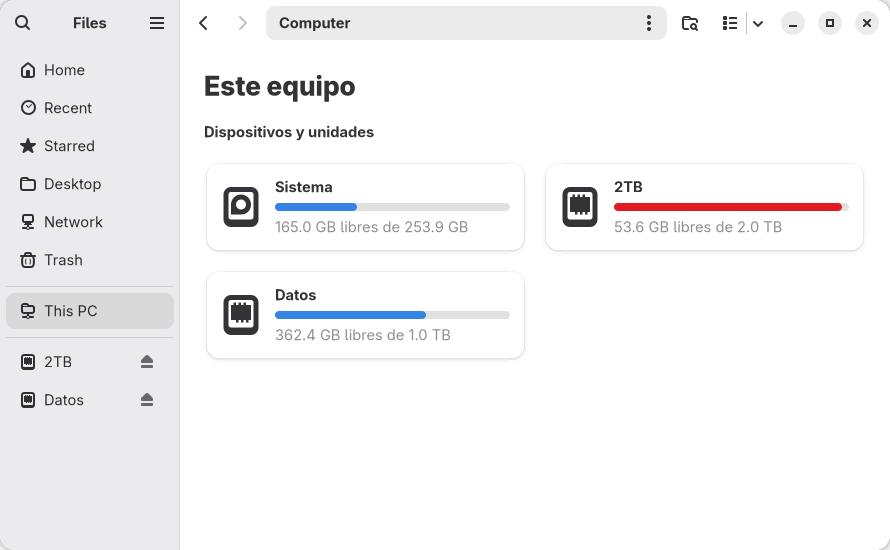

# Disk tiles / Discos en mosaicos

`Extras → Discos en mosaicos` is an opt-in Nautilus extension, not a separate
file manager. Default new Files windows open on `computer:///` (This PC / Este
equipo). Each mounted filesystem has a card with its name, free/total space and
a usage bar. Below 10% free, the bar uses the theme's error colour. Clicking a
card navigates in the same tab; Back returns to the cards. Explicit non-Home
folder launches keep their destination. New tabs retain Nautilus's navigation.



Capacity refresh runs every ten seconds only while a panel is mapped, and when
VolumeMonitor reports device/mount changes. Filesystem queries are asynchronous,
cancellable and limited to 2.5 seconds. Unmounted media are left to Nautilus's
normal sidebar; this feature never mounts, ejects, formats or writes to a drive.
Real local filesystems are deduplicated by mountinfo device id (including btrfs
subvolumes sharing capacity); boot partitions and virtual filesystems are hidden.
Gio supplies labels/icons and mounted remote volumes. Unavailable capacity is
reported as unavailable, not as zero free space.

## Compatibility and startup

Requires Nautilus **50 or 51**, `nautilus-python`, PyGObject, GTK4 and libadwaita.
The prerequisite check reads Arch's package database without launching Nautilus.
No dependency is installed automatically and no administrator permission is used.
Another `nautilus-my-computer` installation is refused to avoid two extensions
competing for the same view.

Nautilus loads Python extensions at process startup. After enabling, close all
Files windows and open Files again once the old process exits. Tool never kills
Nautilus or interrupts file operations. Disabling removes the cards from a
running instance and restores native content. Python cannot unload its imported
module; the dormant directory watcher disappears when that Nautilus process
exits. Re-enabling can be picked up by an existing watcher when the extensions
directory survives; otherwise close and reopen Files again.

Nautilus no longer exposes a public API for custom views. The extension uses
the per-tab `NautilusWindowSlot` stack and the `slot.open-location` action. It
adds a sibling after the native load settles, without reparenting or replacing
Nautilus widgets. Unknown/stalled widget layouts remain untouched. This is a
version-sensitive integration; testing a new Nautilus major version is required
before expanding the supported range. File chooser dialogs are excluded.

This approach was informed by [My Computer for Nautilus](https://github.com/yannmasoch/nautilus-my-computer),
reviewed at commit `ed2f7087daf92b984459f754ce3b1870ba790f5a` (Yann Masoch,
MIT). Tool uses its own limited implementation; it does not install or download
that extension, its settings, column view or disk-management actions.
The reference's [MIT notice](NAUTILUS_REFERENCE_LICENSE.txt) is included for attribution.

## Footprint and ownership

- `$XDG_DATA_HOME/nautilus-python/extensions/omarchy-tool-disk-tiles.py`:
  self-contained extension. A pre-existing file or symlink is never overwritten.
- `$XDG_CONFIG_HOME/gtk-3.0/bookmarks`: one `computer:///` row, only if none
  existed. Existing rows are reused and never owned by Tool.
- `$STATE_DIR/disk-tiles/`: copied `manage.py`, an `enabled` marker and
  `owned.json` recording exact paths, original bookmark bytes, hash of the
  extension and directories created by the feature.
- `$CONFIG_DIR/config.json`: `modules.disk-tiles.enabled`, using Tool's normal
  settings lifecycle. Disabling remembers only the disabled choice; uninstall
  removes Tool's settings.

Activation is idempotent and refreshes the owned extension on plugin updates.
Disable and uninstall share the same manager, copied outside the checkout.
Unchanged bookmark files are restored byte-for-byte, with their mode retained;
if edited during activation, only the exact owned row is removed. User-renamed
rows and unrelated additions remain. Only this extension's `.pyc` files are
removed; directories are removed with `rmdir`, never recursively. Edited or
replaced extension files stop cleanup and retain the ledger for review/retry.
No MIME default, GSettings key, keyboard shortcut, system executable, background
service or existing launcher is changed. Normal Nautilus navigation can still
produce its usual history/metadata; those shared stores are never wiped.

## Verification

```sh
python -B -m unittest discover -s tests
OMARCHY_TOOL_TEST_PARENT=/home/your-user/Work bash tests/run.sh
bash tests/i18n.sh
python -B tests/disk_tiles_integration.py
```

The last command starts a private D-Bus session and Broadway display with
temporary XDG directories. It checks default startup, capacities, real folder
navigation/Back, tabs, explicit-folder launches, live disable and re-enable.
LocalSearch/Tracker activation is blocked only on that private bus: storage
tests do not need a search index. The test asserts neither indexer bus name is
owned, and terminates its whole process groups before deleting temporary files.
It never connects to the user's running Nautilus. Lifecycle unit tests cover
exact restoration, user edits, replacement symlinks, partial installs, updates,
owned bytecode, a deleted checkout and failed privileged uninstall steps.

### Preview-test incident, 2026-10-27

An earlier ad-hoc screenshot harness reused one temporary XDG cache across
preview sessions and did not terminate all D-Bus-activated helpers. A test
LocalSearch process (PID 1209372) aborted at 14:55:16 CDT on `database is locked`,
in `sparql_buffer_flush_cb` (`tracker-indexer.c:955`). Its core environment
confirmed every XDG directory pointed into `/tmp/omarchy-tool-disk-tiles-preview`.
This was the preview's index database, not the user's normal search index.
The extracted diagnostic core was deleted. Preview helpers and their GVfs mount
were retired; the reusable integration test now explicitly prevents indexer
activation. No user service, search settings or index database was reset.
